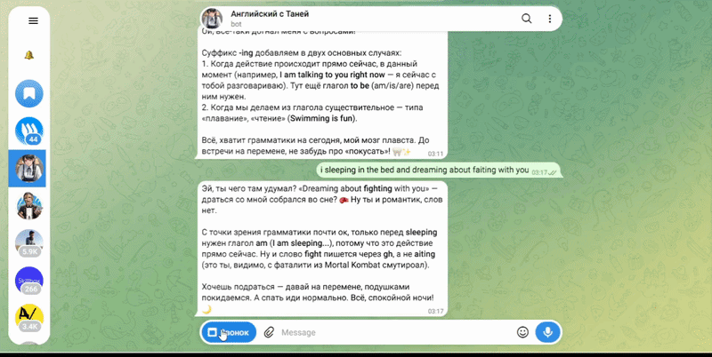

# 🚀 AI-Powered Learning & Memory Assistant (MVP / Тестовый стенд)

> **Статус проекта**: Активная фаза разработки, MVP / стадия тестирования.

Многофункциональный обучающий ассистент на базе Telegram-бота и интерактивного Mini App. Система спроектирована как рабочий прототип конвейера с централизованной памятью на базе Supabase, векторным поиском (RAG), голосовым звонкам через Vapi и бесшовной синхронизацией данных.

---

---

## 📌 Архитектура и ключевые компоненты

* **Telegram Bot & Mini App**: Пользовательский интерфейс для взаимодействия с ассистентом. Фронтенд собран и развернут на **Vercel**.
* **n8n Workflow Engine**: Бэкенд-автоматизация, обрабатывающая логику, вебхуки и передачу данных между сервисами.
* **Supabase (PostgreSQL + pgvector)**: Центральная база данных для хранения информации и векторной памяти (RAG).
* **Vapi (Voice AI)**: Интеграция голосовых звонков для сбора обратной связи и данных.

---

## 🧠 Реализованная логика и инженерные решения

### 1. Инкрементальная обработка памяти
* В базу данных сохраняются **исключительно новые записи** пользователя. Это предотвращает дублирование данных и снижает нагрузку на хранилище при частых запросах.

### 2. Векторный поиск (RAG)
* История взаимодействий и обучающие материалы превращаются в векторные представления, позволяя ассистенту искать релевантный контекст по смыслу, а не по точному совпадению слов.

### 3. Передача данных через вебхуки
* Изменения из n8n или базы данных мгновенно прокидываются через **вебхуки** на веб-страницу приложения, обеспечивая реактивность интерфейса.

### 4. Интеграция Vapi и PostgreSQL
* После завершения голосового звонка через **Vapi** результаты сессии и стенограмма автоматически летят в PostgreSQL, пополняя профиль памяти.

---

## 🛠 Технологический стек

* **Frontend:** HTML5, CSS3, Telegram Web App API (деплой на **Vercel**).
* **Backend:** n8n (Webhook-driven архитектура).
* **Database:** Supabase, PostgreSQL, `pgvector`.
* **Voice & AI:** Vapi.

---

## ⚙️ Анонс
* Переформирование логики записи в базу данных
* Обработка ошибок
* Редактирование промтов агента
* Добавление Delight UX элементов
* Механика отправки ГС
* Переход от Vapi к собственной системе голосовой связи
